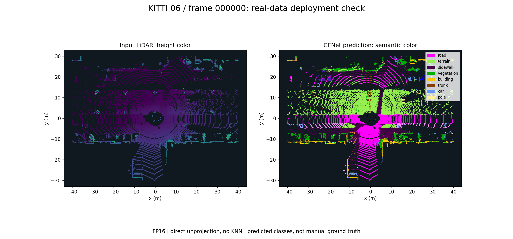

# 本地部署与性能验证

记录日期：2026年11月17日。

## 当前结论与研究安排

RTX 3060 12GB 已完成 CENet 模型加载和200帧真实点云离线推理，可支持当前课程研究。尚未完成 LeGO-LOAM 接入，不能宣称完整系统实时运行或定位性能改善。

采用离线生成语义标签、再回放给 LeGO-LOAM 的实验方式。几何基线、硬剔除、类别软加权及后续时序修正共享同一份输入和预测标签。完整链路实时性作为后续评估目标，不作为当前已完成成果。

## 环境与数据

- 硬件：RTX 3060 12GB，约32GB主机内存，Intel Core Ultra 5 225H。
- 推理环境：WSL2 Ubuntu 22.04，Python 3.10.12，PyTorch 2.5.1+cu121。venv复用已有system-site-packages，并非自包含环境。
- 上游：https://github.com/toustifer/semantic-slam ，提交 dc6b23a4e6568ad4ef0b7652e458c1e6aeb6c508。
- 权重：CENet/CENET/resnet34_traced_forC.pt。
- 权重SHA256：ddc9264a52d912a41ae3f3cade45b70229e93271e7d87bed9c1a5b872f150cdd。
- 数据：KITTI Odometry 06序列000000—000199，共200帧、20.68927秒，点云约374MiB。配套官方标定、时间戳及相机坐标系参考轨迹。评价激光轨迹前须统一坐标系。
- 原始数据由官方 avg-kitti S3 端点分段读取ZIP获取，不保存整个约79GiB压缩包。完整性、帧号连续性及点云有限性检查通过。
- 06在模型配置的训练划分中，仅作为部署验证，不能作为未见场景泛化证据。后续正式实验需独立片段及08等验证数据。

## 测量结果

| 测试 | 精度 | 前向中位耗时 | 前向P95 | PyTorch峰值分配显存 |
| --- | --- | --- | --- | --- |
| 合成输入，50次 | FP32 | 122.27ms | 132.69ms | 1035.18MiB |
| 合成输入，50次 | FP16 | 72.99ms | 81.81ms | 711.09MiB |
| 真实点云，200帧 | FP16 | 59.94ms | 72.98ms | 本轮未单独记录 |

合成测试预热10次，输入1×5×64×2048，计时前后CUDA同步，测试时CARLA同时运行。真实测试与合成测试运行条件不同，不能直接将差异解释为优化收益。

真实测试的脚本处理流程中位耗时为119.57ms，排除首帧预热，包含读取、投影、传输、推理、直接反投影和标签落盘，不是ROS端到端时延。约10Hz输入对应每帧100ms预算，目前串行脚本未达到该预算，且尚未包含KNN和SLAM。不据模型前向耗时承诺整套系统实时。

## 输出与实现边界

200个预测.label文件均与输入点数一致，保持原始点序。反投影采用像素查表，无KNN、置信度过滤、时序融合或ROS。投影按64×2048、+3°/-25°，读取原模型配置的归一化参数。最近点占据像素，点索引0作为有效值，区别于上游Python mask的>0判定。

实际TorchScript模型已经包含softmax，本次不重复应用。旧C++代码二次softmax会影响置信度含义，后续需独立核验，未修改历史实现或据此解释旧精度变化。

模型类别合并了运动与静止对象，car预测不等于moving-car。没有人工语义标签，当前不报告分割准确率，预测图仅作运行结果展示。

## 部署进度与下一步

ROS Noetic官方基础镜像已在E盘Docker Desktop中启动验证，roscpp、catkin_make与GPU设备可见性检查通过。镜像digest为sha256:72b8bc59035dc0a5b8e07aae28c16caa84192971d72d207c72ed734fb1d5e97d。尚需PCL、GTSAM、LibTorch等依赖和编译适配，旧工程引用的point_xyzil_common.h未随上游仓库提供。

下一步先跑原始几何基线，再接入已保存预测标签。先固定地图更新，完成A/B/C对照，再增加跨帧稳定性项及地图更新独立消融。

本机目录为 E:/semantic-slam-local。D盘接近满载，数据和新部署环境存放E盘。本仓库仅保存脚本、小型日志和结果图，不上传模型、KITTI数据或大批量预测标签。

复现入口见 [实验目录说明](../experiments/local_cenet/README.md)。
